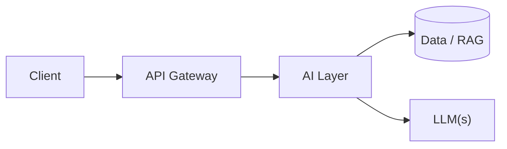

# System Design

```
                ┌→ model A
User → API → router
                └→ model B
           ↓
         cache
           ↓
     retrieval/tools
           ↓
        response
```

## Streaming

## Async APIs

## Rate limits

> Process 1,000 LLM requests concurrently while respecting a rate limit.

## Retries

## Exponential backoff

> Implement retry logic with exponential backoff.

## Timeouts

## Caching

## Semantic caching

## Batching

## Model routing

## Fallback models

## Observability/tracing

## Token usage

## Cost tracking

## Latency

> Your chatbot currently takes 8 seconds to respond. How would you reduce latency?

```
Request
  │
  ├── API / network
  ├── query preprocessing
  ├── embedding
  ├── retrieval
  ├── reranking
  ├── prompt construction
  ├── LLM queueing
  ├── LLM prefill
  ├── LLM decoding
  ├── tool calls / agent loops
  └── postprocessing
  │
Response
```

Agent loops are also a latency multiplier. 

To debug, start with distributed tracing. Give every request a trace ID, then record time spans. The metrics to collect are p50, p90, p99.

For LLMs, track:
- time to first token (TTFT)
- tokens/sec
- input tokens
- output tokens
- queue time
- GPU utilization
- KV-cache utilization

For RAG, track:
- embedding latency
- retrieval latency
- number of candidates
- reranking latency
- number of chunks sent to the LLM
     - to optimize, retrieve fewer chunks, better reranking, deduplicating chunks, compressing retrieved context, summarizing old conversation history, removing redundant system instructions, filtering irrelevant metadata
     
For infrastructure, track:
- CPU, GPU, memory usage
- network
- DB latency
- queue depth
- cache hit rate

## P50/P95/P99

## Concurrency

## Interview Questions

> Build ChatGPT for our company's internal documents.

```
                   ┌──────────────┐
Documents ────────→│ ingestion    │
                   └──────┬───────┘
                          ↓
                      chunking
                          ↓
                     embeddings
                          ↓
                     vector DB
                          ↑
                          │
User → API → auth → retrieval → reranker
                          ↓
                    context builder
                          ↓
                         LLM
                          ↓
                       response
```

> What happens when documents change?  How do you enforce document permissions?  How do you handle 10 million documents?  How do you reduce latency?  How do you evaluate it?  What if retrieval returns irrelevant documents?  How do you prevent hallucinations?  What if OpenAI/Anthropic/etc. goes down?

## Answer Frameworks 

1. Scope and Clarify
     - What is the scale? (users, requests, data volume) 
     - What are the latency requirements?
     - What accuracy or quality bar must we meet?
     - Are there compliance or security requirements?
     - What is the existing infrastructure?
     - What is the budget constraint?
     - E.g. "what volume are we expecting? Thousands or millions of conversations per day? Is this customer-facing or internal support? What languages need to be supported? Do we need to integrate with existing ticketing systems? What is our accuracy target for resolved vs escalated"
2. Prioritize requirements
     - Create a priority matrix:
     - Requirement | Priority | Implication
     - Low latency | High | may limit model size
     - High accuracy | High | Need good retrieval + eval
     - Cost efficiency | Medium | Optimize with caching
     - Multi-language | Medium | Affects embedding choice
3. Initial Architecture
     - Draw the high-level system before diving into details.

     - Explain each component briefly: What it does, why it is needed, what alternatives exist
4. Deep dive critical paths
     - What is novel or complex about this system
     - Where the biggest risks lie
     - Example deep dives: 
          - RAG pipeline: chunking, embedding, retrieval, reranking
          - Agent loop: tool selection, error handling, termination
          - Data pipeline: ingestion, processing, indexing
          - Security: isolation, permissions, audit
5. Evaluation and Observability
     - Metrics: What do you measure?
     - Evaluation: How do you know it works?
     - Monitoring: How do you detect problems?
     - Alerting: When do humans get paged?
     - Standard metrics for AI systems:
          - Latency (p50, p95, p99)
          - Token usage / cost
          - Quality scores (offline and sampled online)
          - Error rates by type
          - Cache hit rates
6. Reliability and Scale
     - Failure modes to discuss:
          - LLM provider outage
          - Rate limiting
          - Bad model outputs
          - Data pipeline failures
          - Cache invalidation
     - Scaling considerations:
          - Where are the bottlenecks?
          - What scales horizontally vs vertically?
          - What costs scale with usage?

## Debugging/Troubleshooting Framework
1. Gather Information 
     - When did this start? What changed?
     - Is it all requests or a subset?
     - What does the error look like exactly?
     - Are there patterns (time of day, user segment, query type)?"
2. Form Hypotheses
     - Based on the symptoms, the top hypotheses are:
     - Retrieval quality degraded (recent data changes?)
     - Model output quality dropped (prompt changed? different model?)
     - Context length exceeded (longer documents?)
     - Rate limiting causing timeouts"
3. Describe Diagnostic Approach
     - To isolate the cause:
     - Check traces for failing requests to see where they diverge
     - Compare retrieval results to a known-good baseline
     - Check model version and prompt version in deployment
     - Review metrics for any correlated changes"
4. Propose Fixes and Verification 
     - If it is retrieval quality:
     - Re-index with verified chunking
     - Validate on test set before deploying
     - Roll out gradually with A/B comparison
     - Set up alerts on retrieval quality metrics to catch future issues"

## Mixture of Experts (MoE)

Instead of using one big network for every input, the model has many smaller networks called experts and only activates a few of them for each input. 

In simple words: **Mixture of Experts** = Many small expert networks + A router that picks which ones to use.

Think of it like a hospital. A hospital does not have one single doctor who treats every patient. It has many specialists - a heart specialist, a skin specialist, a brain specialist, and so on. When a patient walks in, a receptionist (the router) sends them to the right specialist (the expert). The patient does not need to meet every doctor in the hospital. They only meet the ones who are relevant to their problem.

Before MoE, large language models were dense. Dense means every token uses every single parameter of the model. If a model has 100 billion parameters, every token uses all 100 billion parameters during inference.

This had two big problems:
- **Compute cost**: As models grew bigger to become smarter, the compute cost grew with them. A bigger model meant slower inference and higher GPU bills for every single token.
- **Wasted capacity**:  Not every input needs every part of the model. Different inputs benefit from different sub-networks, but in a dense model, every input is forced to pass through every parameter, whether it needs them or not.
