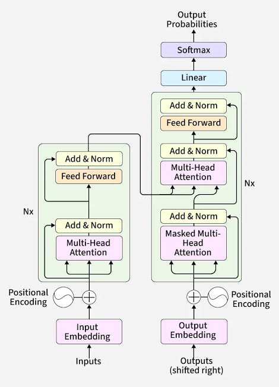

# Transformer Architecture

See https://poloclub.github.io/transformer-explainer/

## Architecture Diagram

## Key Components

1. Embedding
    - Tokenizing text input, and converting tokens into vectors (a.k.a embeddings) via index lookup into a dictionary using unique token IDs, which capture the semantic meaning of words
    - 
2. Transformer block, consisting of the attention mechanism, and MLP (multi-layer perceptron), a feed forward network which refines each token's representation
3. Output Probabilities
    - The final linear and softmax layers which transforms the contextualized embeddings into probabilities, enabling the model to make predictions on the next token in a sequence

## Positional Encoding 

> Why do transformers need positional information?

Positional encoding is a technique used in transformer models to inject information about the relative or absolute position of tokens in a sequence.
- **Parallel processing**: Unlike Recurrent Neural Networks (RNNs) that process text one word at a time, transformers process all tokens at once
- **Order blindness**: The self-attention mechanism treats inputs as an unordered set, meaning "cat eats fish" and "fish eats cat" would look identical without extra signals
- **Context preservation**: Positional data helps the model distinguish word order and sentence structure

The token and positional encodings are summed to produce the final embedding representation. This combined representation captures both the semantic meaning of the tokens and their position in the input sequence.

Types of Positional Encoding:
- **Learned Positional Encoding**: Treats each position index as a trainable parameter updated during model training
    - $x_i'= x_i+p_i$, $X'=X+P$
- **Sinusoidal Positional Encoding**: Uses fixed sine and cosine functions of varying frequencies to generate deterministic position vectors added directly to token embeddings
- **Rotary Positional Encoding (RoPE)**: Multiplies the query and key vectors by a rotation matrix to encode relative distances, which works well for handling longer context windows
    - Rotate the Q and K vectors by an angle that depends on the token's position.The further along a token is in the sequence, the more we rotate its vector.
    - When we compute the attention score $Q \cdot K$, the rotations combine in a way that the result depends only on the difference in positions between the two tokens, not on their absolute positions.

## Self-Attention

The core component of the Transformer block. It allows tokens to communicate with other tokens, capturing contextual information and relationships between words.

### Query, Key, Value

The transformer has learned weight matrices $W_q$, $W_k$, $W_v$.

$$
\boxed{Q=XW_q} \qquad \boxed{K=XW_k} \qquad \boxed{V=XW_v}
$$

- Query = What information am I looking for?
- Key = What kind of information do I contain?
- Value = What information should I give you if you attend to me?

$QK^T$ produces the attention matrix, which gives a score for each pair of tokens, indicating how much attention one token pays to another.

> Why divide attention logits by $\sqrt{d}$? (dimension of head)

Imagine query/key dimensions are large: e.g. $q,k\in \mathbb{R}^{128}$. Their dot product $q\cdot  k=q_1k_1​+\dots+q_{128}​k_{128​}$. As dimensionality grows, the magnitude of these dot products tends to grow too.

That causes problems when we apply softmax. If
$ z=[1,2,3] $ softmax gives a reasonably distributed result. But: $ z=[10,20,30] $ produces something extremely concentrated around the largest number.

Thus scaling by $\sqrt{d_k}$ keeps the variance of the attention logits under control. In other words, it helps to stabilize the gradients and prevent them from growing too large to compute efficiently as the dimensionality of the vectors increases.

*Softmax* then turns attention scores into weights. This is multiplied by $V$ to produce the attention vector.

$$
\text{Attention}(Q,K,V)=\text{softmax}\left(\frac{QK^T}{\sqrt{d_k}}\right)V
$$

### Multi-head Attention

Run multiple self-attention operations in parallel to capture diverse relationships and patterns from different representation subspaces.

Say the model has $d_{model}=512$ (512 dimensions). Each head might have $d_k=d_h=64$ dimensions. 
- Each head has its own projection $W_Q^{(i)}, W_K^{(i)}, W_V^{(i)}$

Multiple attention heads allow the model to consider these relationships from different perspectives; for example, one head may capture short-range syntactic links while another tracks broader semantic context.
- The input vectors are projected multiple times into queries (Q), keys (K), and values (V) using different, independently learned weight matrices for each head
- Each head independently computes scaled dot-product attention on its lower-dimensional subspaces
- The individual output vectors from all parallel heads are joined back together side by side
- A final learned linear transformation matrix combines the concatenated outputs to restore the desired model dimension

Benefits
- Different heads can focus on distinct linguistic or spatial features (such as who is performing an action versus where it happens)
- Operating in parallel across smaller dimensions matches the computational cost of a single large attention head while offering richer contextual understanding

### Cross Attention

Same as attention, but $Q$ and $K$, $V$ come from different embeddings. E.g. in the decoder layer, it uses $Q$ from its own hidden layer, and $K$ and $V$ from the encoder stack.

### Multi-Query Attention (MQA)

All queries share a single Key and Value matrix.

### Grouped-Query Attention (GQA)

A generalization of MHA and MQA. Heads are divided into groups, and each group shares the same single Key and Value. Each head still has its own Query.

### Causal Masking

Mask the top right triangle of the attention matrix. Prevents the transformer from accessing future tokens.

$$
\text{Attention}(Q,K,V)=\text{softmax}\left(\frac{QK^T}{\sqrt{d_k}}+M\right)V
$$

where $M_{ij}=\begin{cases}0 & j\leq i \\ -\infty & j>i\end{cases}$

Suppose $S=\frac{QK^T}{\sqrt{d_k}}=\begin{bmatrix}2 & 3 & 1\\ 4 & 1 & 5 \\ 2 & 7 & 3\end{bmatrix}$, then $M=\begin{bmatrix}0 & -\infty & -\infty\\ 0 & 0 & -\infty \\ 0 & 0 & 0\end{bmatrix}$ 

## Softmax

Converts a vector of raw, unnormalized scores (called logits) into a valid probability distribution where all values range between 0 and 1 and sum up to exactly 1:

$$
\sigma(x_j)=\frac{e^{x_j}}{\sum_i e^{x_i}}
$$

- It applies the exponential function $(e^{x})$ to each raw score
- This turns all negative and positive numbers into positive values and amplifies the differences between the scores
- It divides each exponentiated value by the sum of all the exponentiated values in the vector. This step forces the final outputs to add up to 1 (normalization)

## Residual connection (Add)

A.k.a skip connection

Adding $X$ to $\text{MHA}(X)$ so as to not lose the original representation.

The intuition is: "Here's the original information, plus whatever useful transformation attention learned.".  This makes very deep networks easier to optimize because information and gradients can flow through the identity path.

## LayerNorm (Normalization)

Layer normalization normalizes the activations within each token's feature vector.

You compute the mean $\mu$ and variance $\sigma^2$ of a token, then normalize each component 
$$
\hat{x_i}=\frac{x_i-\mu}{\sqrt{\sigma^2 + \epsilon}}
$$

Using learnable parameters $\gamma$ and $\beta$, the output is $\text{LN}(x)=\gamma \hat{x}+\beta$

The important intuition is simply: LayerNorm keeps the scale/distribution of activations under control.

## Feed Forward Network (FFN)

Feed-Forward Networks refine the understanding of each word individually. The MLP block consists of two linear transformations with a GELU activation function in between.
- Multiplies embedding by trained weight matrices and applies non-linear activations (like ReLU or GELU).
- Typically projects data into a much wider hidden layer before shrinking it back down.

$$
\text{MLP}(x)=W_2\sigma(W_1x+b_1)+b_2
$$

where $\sigma$ may be GELU, or in many modern LLMs, a gated activation such as SwiGLU.

For example,

$$
\underbrace{\mathbb{R}^{4096}}_{d_{model}}\xrightarrow{W_1}\underbrace{\mathbb{R}^{11008}}_{d_{ff}}\xrightarrow{activation}\mathbb{R}^{11008}\xrightarrow{W_2}\underbrace{\mathbb{R}^{4096}}_{d_{model}}
$$

The first linear transformation expands the dimensionality of the input. 
- This expansion step allows the model to project the token representations into a higher-dimensional space, where it can capture richer and more complex patterns that may not be visible in the original dimension.

The second linear transformation then reduces the dimensionality back to the original size. 
- This compression step brings the representations back to a manageable size while retaining the useful nonlinear transformations introduced in the expansion step.

Unlike the self-attention mechanism, which integrates information across tokens, the MLP processes tokens independently and simply maps each token representation from one space to another, enriching the overall model capacity.

## Cross-entropy loss

Measures the performance of a classification model whose output is a predicted probability between 0 and 1. Used in training, together with backpropagation and optimizer, to find the best parameters and weights that minimize loss.

Formula:

$$
CE=-\sum_i y_i\log (p_i)
$$
where $y_i$ are the true labels, and $p_i$ are the predicted labels

- It calculates the difference between the true probability distribution (the actual labels) and the predicted probability distribution (**quantify error**)
- Because it uses a logarithm, it heavily penalizes wrong predictions when the model is highly confident (**penalize confidence**)
- Lower loss values indicate that the model's predicted probabilities align closely with the true labels (**rewards accuracy**)

*Binary* Cross-Entropy is used when there are only two classes (0 or 1), such as spam detection or medical diagnosis.

*Categorical* Cross-Entropy is used when there are three or more classes, often paired with a softmax activation function

The word *Cross-Entropy* comes from information theory. Cross-Entropy = Cross + Entropy
- **Entropy** measures the uncertainty of a probability distribution. If a coin is perfectly fair (50% heads, 50% tails), the entropy is high because we are very unsure about the outcome. If a coin always lands heads (100% heads, 0% tails), the entropy is zero because there is no uncertainty.
- **Cross** means we are comparing two distributions: the true distribution (what should happen) and the predicted distribution (what our model thinks will happen).

So, Cross-Entropy measures the uncertainty we have when we use the predicted distribution to describe events that actually follow the true distribution. If the two distributions are identical, the cross-entropy is at its minimum. If they are very different, the cross-entropy is large.

Suppose we have a weather forecaster who every morning announces the chance of rain, sunshine, and snow as probabilities (e.g. "60% rain, 30% sunshine, 10% snow"). 
- If she says "90% rain" and it rains, she gets a very small penalty. Great forecast.
- If she says "90% sunshine" and it rains, she gets a huge penalty. She was confidently wrong.
- If she says "34% rain, 33% sunshine, 33% snow" (completely unsure) and it rains, she gets a moderate penalty. Hedging is neither punished heavily nor rewarded.

Cross-Entropy Loss is exactly this scoring system. The model is the forecaster, the softmax output is the probability announcement, and the true label is what actually happened.

We take negative log because the log of a number between 0 and 1 is always negative, so taking negative log flips the sign and assigns a positive loss value.

## Next-token prediction

The embedding passes through multiple blocks of transformers (self attention + MLP block) to produce a highly contextualized embedding. 

After the input has been processed through all Transformer blocks, the output is passed through the final linear layer to prepare it for token prediction.

This layer projects the final representations into a $\mathbb{R}^V$ dimensional space, where $V$ is the dictionary/vocabulary size. Every token in the vocabulary has a corresponding value called a logit. Any token can be the next word, so this process allows us to simply rank these tokens by their likelihood of being that next word.

The softmax function is used to convert the logits into a probability distribution that sums to one. This allows us to sample the next token based on its likelihood.

## Temperature, top-k, top-p

Used to sample the next token to output.

> What does temperature actually do to the token distribution?

Logits are divided by temperature value
- Temperature = 1, no effect
- Temperature < 1, big values get bigger, small values get smaller, sharpening the probability distribution
- Temperature > 1, values become 'fairer', output becomes more 'creative' and randomized

Top-k: After scaling logits, limits the candidate tokens to the top k tokens with the highest probabilities, filtering out less likely options.

Top-p: Considers the smallest set of tokens whose cumulative probability exceeds a threshold p, ensuring that only the most likely tokens contribute while still allowing for diversity.

By tuning temperature, top-k, and top-p, you can balance between deterministic and diverse outputs, tailoring the model's behavior to your specific needs.

## Context windows

- Context window = LLM's working memory 
- Includes the full chat history, instructions, the prompt, tool outputs etc.
- Context window is measured in tokens, not words
- When context window is exceeded, quality degrades, the LLM may discard/drop old messages 
- To manage context windows, 
    - keep prompts short and focused 
    - summarize chat history
    - use RAG to fetch only relevant chunks instead of dumping the full document
    - remove tool results once processed 

## KV cache

> What's stored in the KV cache?

In large contexts, the transformer must recompute $K$ and $V$ each time, which gets expensive and time-consuming. The KV cache stores previously computed keys and values for each token and reuses them instead of recomputing, thus speeding up the processing for each token.

## Inference in Long Contexts

> Why does increasing context length make inference expensive?

It swells the Key-Value (KV) cache and spikes memory bandwidth demands

- The model stores key and value tensors for every token in the prompt. This cache grows linearly with context length and consumes precious GPU memory
- During token generation, the GPU must constantly read the entire KV cache from memory for every single new token produced. This creates a hardware bottleneck known as the "memory wall'
- Processing a massive initial prompt requires a heavy compute pass (**prefill phase**) that scales significantly with the length of the input

## Pretraining vs instruction tuning vs fine-tuning

## SFT vs RLHF / preference optimization

## Hallucinations and why they happen

An LLM is fundamentally trained to model $P(next token | previous tokens)$. It isn't inherently a database lookup engine.

For questions that the LLM has little to no reliable training on, it is still trained to produce the most likely continuation. So it might generate something that sounds plausible but is actually incorrect. The core issue is: plausible != true. The model is optimizing for predicting text, not directly optimizing for truth.

## Architecture Choice

> When do you choose between encoder-only, decoder-only, and encoder-decoder Transformer architectures?

- Encoder-decoder is used for when you want to *transform* the input to some output
    - E.g. translating from one language to another, convert one form of document to another
- Decoder only
    - Most GPT-style (generative pretrained transformer) LLMs are decoder only. You can turn almost everything into next-token prediction.
- Encoder only
    - Used when you want to *understand* something, rather than generate something

## Model Distillation

Model distillation is a machine learning technique where a compact "student" model is trained to replicate the behavior and predictions of a larger, more complex "teacher" model
- The Teacher Model is a massive, pre-trained artificial intelligence model with billions of parameters that acts as the knowledgeable expert
- The Student Model is a smaller, more efficient neural network architecture designed to learn from the teacher.

Instead of training solely on raw data labels, the student learns from the soft probability outputs (logits) or intermediate states generated by the teacher, capturing nuanced patterns and relationships known as "dark knowledge"

Benefits:
- Drastically reduces memory usage, compute costs, and response latency during inference (efficiency)
- Allows powerful artificial intelligence capabilities to run on resource-constrained hardware like mobile devices, laptops, and edge devices

## Interview Questions

> Your LLM keeps ignoring your instructions. How do you make it follow structured output formats?

- Schema-constrained decoding + validation
- Don't rely only on prompting. Use the model/API's structured-output or constrained-decoding capability with a JSON schema if available. 
- Then validate the returned object programmatically. If validation fails, retry or repair the output. 
- For models without constrained decoding,use clear formatting instructions and examples, but still treat the output as untrusted and validate it.
- Key distinction:
    - Prompting: asks the model to follow the format.
    - Constrained decoding: restricts which tokens can legally be generated.
    - Validation: ensures your application never blindly trusts the output.

 

> Your LLM-powered tool hits the context window limit on long documents. How do you handle it?

- RAG / chunking / hierarchical processing 
- Avoid putting the entire document into the prompt. The solution depends on the task. 
- For QA, use RAG: chunk the document, retrieve relevant chunks, potentially rerank them, and only provide relevant context. 
- For summarization or tasks requiring the entire document, use hierarchical or map-reduce summarization, where sections are processed separately and their outputs are recursively combined. 
- Also remove redundant context and use context compression where appropriate.

 

> Your LLM does not admit when it does not know the answer. How do you make it say "I don't know"?

- Grounding + calibrated abstention
- Explicitly define when the model should abstain, but prompting alone isn't reliable. 
- For a grounded QA system,  retrieve evidence and require the answer to be supported by that evidence.
- If retrieval confidence or supporting evidence is below a calibrated threshold, return "I don't know" rather than calling the generator normally. 
- Evaluate this using a dataset containing both answerable and unanswerable questions
- Caveat: A fixed threshold isn't universally meaningful. Calibrate it empirically against the evaluation set.

 

> Your LLM generates responses that are too verbose. How do you control response length?

- Explicit format + output token bound
- First constrain it at the instruction level: specify the desired format, number of bullets/sentences, or word range.
- Also set an output-token limit as a hard upper bound. If exact limits matter, validate the output and potentially regenerate or truncate intelligently.
- For example: "Answer in at most three bullet points, each one sentence."
- Don't rely on `max_tokens` alone because it can chop the response off mid-sentence.

 

> Your LLM memorized proprietary training data and leaks it in responses. How do you prevent this?

- Data governance + access control + remediation
- This is a data governance + privacy + model training problem, not something prompt engineering can reliably fix.
- Ideally, proprietary data that the model isn't permitted to reproduce shouldn't have been included in training in the first place. 
- Establish dataset provenance, access controls and filtering before training. 
- If the model is already trained, evaluate memorization using extraction/red-team tests and consider retraining without the affected data or using appropriate unlearning/remediation techniques. 
- At inference time, add defense-in-depth controls such as authorization, sensitive-data detection and output filtering, but those aren't substitutes for fixing the underlying model/data problem.
- For application-specific proprietary knowledge, often: RAG + access control is preferable to baking frequently changing private information into model weights.
    - With RAG you can enforce: User -> authorization -> retrieve only documents user may access -> LLM, and revoke/update documents without retraining the model.

 

> Your LLM coding assistant generates outdated code using deprecated libraries. How do you fix it?

- RAG with current authoritative sources
- The model's parametric knowledge is stale, so prompting alone won't solve it
- Use current authoritative documentation retrieved at runtime
- Index the relevant library docs, retrieve documentation matching the user's version, rerank it, and provide that context to the model
- Also validate generated code using compilation, tests, static analysis or execution in a sandbox where appropriate.

 

> Your tokenizer splits important domain terms into meaningless subword pieces. How do you fix it?

- Measure first; tokenizer/vocab adaptation if warranted
- First, splitting isn't automatically a problem - transformers are designed to operate over subword tokens.
- But if domain terminology is consistently tokenized very inefficiently and hurts performance/cost,
- First measure whether tokenization is actually causing degradation
- If training or substantially adapting the model, train a domain-specific tokenizer or extend the existing vocabulary with important domain tokens. 
- New token embeddings then need to be initialized and trained. But changing the tokenizer of an already pretrained model isn't free—the model's embedding and output vocabulary are coupled to that tokenizer, so generally only do this when further training is available and the measured benefit justifies it.
- Potential approaches:
    - domain-specific tokenizer during model training
    - extend vocabulary + resize embedding/output layers + continued training
    - domain adaptation/fine-tuning
    - leave tokenizer alone if subword splitting isn't actually harming performance
- Rather than "just add the word to the tokenizer"

 

> Your Transformer's KV cache grows too large during long sequence generation. How do you manage memory? 

- GQA/MQA, quantization, PagedAttention

 

> Your Transformer runs out of memory on long documents due to quadratic self-attention. How do you scale it?

- Paged Attention, FlashAttention, sparse/windowed attention, RAG

 

> Your chatbot loses context after 10 turns in a conversation. How do you maintain a long conversation context? 

- Recent context + summaries + retrieved memory

 

> Your chatbot fails when users switch topics mid-conversation. How do you handle topic switches?

- Relevance-based memory/context selection
- AI agent memory

 

> Your summarization system hallucinated facts not in the original article. How do you fix it?

- Grounding + claim verification

 

> Your text generation repeats phrases in long outputs. How do you fix repetition?

- Decoding controls + prompt/data diagnosis

## References

- https://github.com/amitshekhariitbhu/ai-engineering-interview-questions
