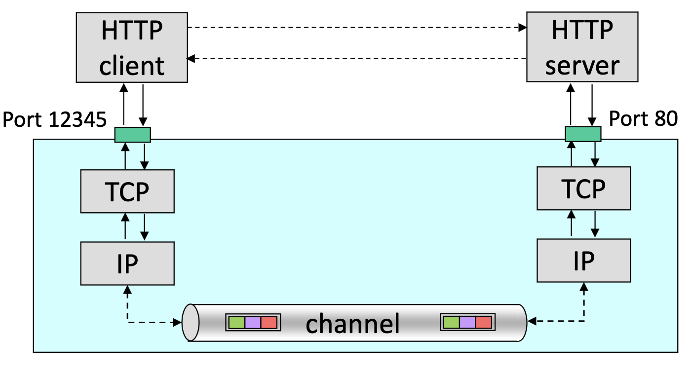

# Basics

From [CS2105 Introduction to Computer Networks](https://nusmods.com/courses/CS2105/introduction-to-computer-networks)

## Application Layer 

### DNS

## Transport Layer 

A Web page consists of a **base HTML file** and **some other objects** referenced by the HTML file

HTTP uses **TCP** as transport service. TCP, in turn, uses service provided by IP

- Two main protocols: TCP, UDP
- Transport layer protocols run in hosts.
    - Sender side: breaks app message into segments (as
    needed), passes them to network layer (aka IP layer).
    - Receiver side: reassembles segments into message,
    passes it to app layer.
    - Packet switches (routers) in between: only check
destination IP address to decide routing.

### UDP
- UDP adds very little service on top of IP:
    - Multiplexing at sender: UDP gathers data from
    processes, forms packets and passes them to IP
    - De-multiplexing at receiver: UDP receives packets from lower layer and dispatches them to the right
    processes.
    - Checksum
- UDP transmission is unreliable
    - Often used by streaming multimedia apps (loss tolerant & rate sensitive)
- Benefits of UDP
    - No connection establishment (which can add delay)
    - Simple: no connection state at sender, receiver
    - Small header size
    - No congestion control: UDP can blast away as fast as desired
- Format: 
    - [source port (16 bits)] [dest port (16 bits)] [length (16 bits)] [checksum (16 bits)] [ app data (message) ]
    - UDP header is prepended in front of message 
- Checksum
    - Add in 16 bits, wraparound carry
    - Take 1's complement -> checksum
    - If checksum is incorrect, discards the packet
    - Checksum only detects corruption, it does not correct errors or recover packets 
    - IPv6 mandatory checksum, IPv4 optional (set to `0xFFFF`)

Reliable Data Transfer (RDT)

| rdt Version | Scenario | Features Used |
|-|-|-|
|1.0|no error|nothing|
|2.0|data bit error|checksum, ACK/NAK|
|2.1|data bit error, ACK/NAK error bit error|checksum, ACK/NAK, sequence number|
|2.2|same as 2.1|NAK free|
|3.0|data bit error, ACK bit error, packet loss|checksum, ACK, sequence number, timeout/re-transmission 

### TCP

## Network Layer
