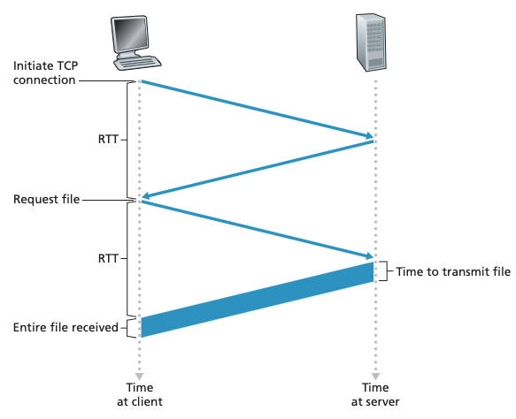
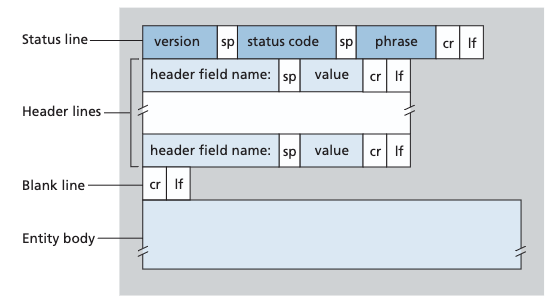
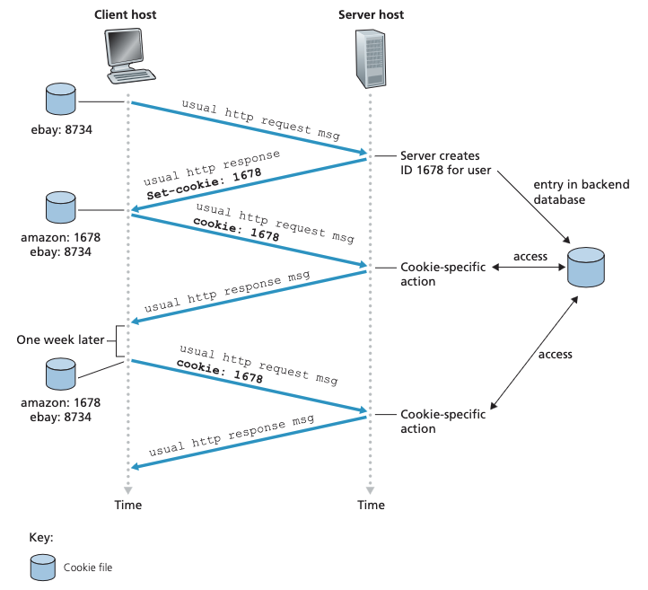
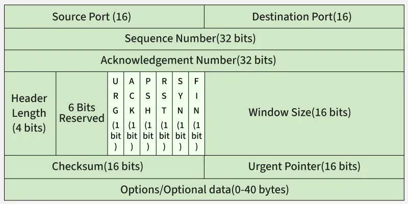

# CS2105

From [CS2105 Introduction to Computer Networks](https://nusmods.com/courses/CS2105/introduction-to-computer-networks)

## Overview

- Packet Switches
    - two predominant types: routers, link-layer switches
    - time to transmit: $L/R$ for $L$ bits and $R$ bits/sec transmission rate
    - time to transmit one packet over $N$ links: $N\cdot L/R$
    - transmit $p$ packets over $N$ links: $(N+p-1)\cdot L/R$
- Store-and-Forward Transmission
    - the packet switch must receive the entire packet before it can begin to transmit the first bit of the packet on the outbound link
- Queueing Delay
    - each packet switch can have multiple links attached to it
    - for each outgoing link, the packet switch has an output buffer/queue. if the outgoing link is busy transmitting another packet, packets destined for that link must wait in the queue
    - thus packets suffer from queueing delay
- Packet Loss
    - if the buffer is completely full, either the arriving packet or one already queue is dropped
    - lost packets may be retransmitted
- Forwarding Tables
    - each router has a forwarding table which maps destination addresses to outbound links
    - routing protocols are used to automatically set the forwarding tables. a routing protocol may find the shortest path from each router to each destination, and use the shortest paths to configure the forwarding table
- Circuit switching
    - reserve a portion of the link transmission capacity, guaranteed constant rate, no queueing
    - compared to packet switching where packets may be queued
    - analogy is restaurant reservations
    - packet switching simpler and less costly to implement, circuit switching is better for real time services
    - packet switching offers better sharing of transmission capacity e.g. a connection is idle 90% of the time but will still reserve transmission capacity 
    - packet switching is "on demand"
- Network of networks
    - there are lower-tier (access ISP/regional ISP) and higher-tier ISPs (tier 1 ISP, IXP, content provider e.g. Google). lower-tier ISPs connect to the higher-tier ISPs, and the higher-tier ISPs interconnect with one another
- Types of delay
    - Node processing delay, queueing delay, transmission delay, propagation delay
    - processing delay: examine packet header, determine where to route, check for bit errors
    - transmission delay: $L/R$, the time it takes to push all of a packet's bits onto the link
    - propagation delay: time required to propagate from the beginning to the end of the link. propagation speed of the link depends on the physical medium (fiber optics, coaxial etc.). time is $d/s$
    - $d_{nodal}=d_{proc}+d_{queue}+d_{trans}+d_{prop}$
    
### Layers 

Each protocol belongs to a layer. Each layer offers a service. The protocols form a protocol stack.
- OSI Model: Application, Presentation, Session, Transport, Network, Data Link, Physical
- TCP/IP: Application, Transport, Network, Data Link, Physical (the course follows this one)
    - Application: HTTP/S, DNS, FTP, SMTP etc. (to do with application specific logic, the highest level)
        - packets in application layer are called *messages*
    - Transport: TCP, UDP (*how* to send packets - ordered/unordered, reliable/unreliable, flow/congestion control etc.)
        - Sockets: software interface between app and transport layer
        - Transport-layer packets are called *segments*
    - Network: IP, ICMP, Routing protocols (*identifying* the correct device to send to, and how to *route* to them)
        - network-layer packets are called *datagrams*
    - Link layer: Ethernet, Wi-Fi. Ensures reliable delivery from one end to another
        - Link-layer packets are called *frames*
    - Physical layer: move individual bits within a frame from one node to another. Depends on the type of link and medium (fiber optic, twisted-pair copper wire etc.)
- Each layer adds header fields to the payload
    - the payload is typically the packet from the layer above
    - each layer encapsulates the layer above it

### Security

- DDoS (Distributed Denial of Service): render service unavailable to actual users by flooding the server with TCP connections (*connection flooding*), packets (*bandwidth flooding*), or vulnerability attack
- Packet Sniffer: receive a copy of every packet, which can include sensitive data like passwords
    - Even wireshark is considered a packet sniffer
    - Prevention: cryptography
    - Packet sniffers are passive and hard to detect
- IP spoofing: inject packets with a false source address. Pretend to be another user

### Review Questions

> What is the difference between a host and an end system? Is a web server an end system?

> List four access technologies, classifying them as home, enterprise or wide-area wireless acess

> What is the transmission rate of Ethernet LANs?

> What are some of the physical media that Ethernet can run over?

> Suppose there is exactly one packet switch between a sending host and a receiving host. The transmission rates between the sending host and the switch and between the switch and the receiving host are R1 and R2, respec- tively. Assuming that the switch uses store-and-forward packet switching, what is the total end-to-end delay to send a packet of length L? (Ignore queu- ing, propagation delay, and processing delay.)

> Consider sending a packet from a source host to a destination host over a fixed route. List the delay components in the end-to-end delay. Which of these delays are constant and which are variable?

> How long does it take a packet of length 1,000 bytes to propagate over a link of distance 2,500 km, propagation speed $2.5 \cdot 10^8$ m/s, and transmission rate 2 Mbps? More generally, how long does it take a packet of length L to propagate over a link of distance d, propagation speed s, and transmission rate R bps? Does this delay depend on packet length? Does this delay depend on transmission rate?

## Application Layer 

- Client-server architecture: there is an always-on host (the *server*) which services requests from many other hosts (*clients*)
    - Server has a well-known, fixed IP address
    - Data center houses a large number of hosts e.g. Google, Amazon, Youtube
- Peer-to-peer (P2P) architecture: minimal to no reliance on dedicated servers 
    - Direct communication between pairs of hosts called *peers*
    - E.g. BitTorrent
    - Self-scalability is a big feature of P2P architecture 
    - Highly decentralized, but face security, reliability and performance issues 
- Communication
    - Processes on hosts communicate with each other by sending messages 
    - A process sends messages into, and receives m essages from, the network through a software interface called a *socket*
    - A socket is the interface between the application layer and the transport layer within a host 
    - The only control that the application developer has on the transport-layer side is (1) the choice of transport protocol and (2) some of the transport-layer parameters like maximum buffer/segment size
    - Processes connect to sockets which are identified by their IP and port number. Certain port numbers are reserved e.g. 80 for HTTP, 443 for HTTPS, 25 for SMTP 
- Transport layer 
    - Provides application layer with reliable data transfer (rdt), throughput, timing, security 
    - rdt ensures data is not lost and sent and received without errors 
    - timing guarantees: ensure that a bit is received no more than X ms, important for real-time applications
- Examples of network applications

|Application|Data Loss|Throughput|Time-Sensitive|
|-|-|-|-|
|File transfer/download| No loss| Elastic| No|
|E-mail| No loss| Elastic| No|
|Web documents| No loss| Elastic (few kbps)| No|
|Internet telephony/Video conferencing| Loss-tolerant |Audio: few kbps–1 Mbps, Video: 10 kbps–5 Mbps|Yes: 100s of msec|
|Streaming stored audio/video|Loss-tolerant| Same as above| Yes: few seconds|
|Interactive games| Loss-tolerant| Few kbps–10 kbps| Yes: 100s of msec|
|Smartphone messaging| No loss| Elastic| Yes and no|

- TCP services
    - connection-oriented service: client and server exchange transport-layer control information before the app-level messages begin to flow (*handshake* phase)
        - after the handshake, a TCP connection exists between the sockets. the connection is full-duplex
        - when the app finishes sending messages, it must tear down the connection
    - reliable data transfer: processe can rely on TCP to deliver all data sent without error, and in the proper order
        - bytes are delivered with no missing or duplicate bytes
        - TCP includes a congestion-control mechanism to throttle a sending process
- UDP services
    - lightweight transport protocol, connectionless
    - unreliable data transfer, no guarantee that the message reaches the process, and messages can arrive out of order
    - no congestion-control mechanism
        - the sending side can pump data into the layer below at any rate 
        - the actual end-to-end throughput may be lower due to limited transmission capacity of links or due to congestion
- Security
    - neither TCP nor UDP provide encryption
    - Transport Layer Security (TLS) is an enhancement of TCP, with the enhancements implemented in the app layer
    - if an app wants to use TLS, it needs to include TLS code in both client and server
    - TLS has its own socket API similar to traditional TCP socket API
    - TLS encrypts the data, then passes it to the TCP socket
    - the receiving socket passes the encrypted data to TLS for decryption
- Services not provided by transport layer
    - No timing or throughput guarantees
- Applications and their app-layer and underlying transport protocols

|Application|Application-layer Protocol|Transport Layer Protocol|
|-|-|-|
|Electronic mail| SMTP [RFC 5321]|TCP|
|Remote terminal access| Telnet [RFC 854]|TCP|
|Web|HTTP 1.1 [RFC 7230]|TCP|
|File transfer|FTP [RFC 959]|TCP|
|Streaming multimedia|HTTP (e.g., YouTube), DASH|TCP|
|Internet telephony|SIP [RFC 3261], RTP [RFC 3550], or proprietary (e.g., Skype)|UDP or TCP|
- Many firewalls are configured to block (most types of) UDP traffic, Internet telephony applications often are designed to use TCP as a backup if UDP communication fail
- App layer protocols define
    - The type of messages, e.g. response, request
    - The syntax of messages, e.g. fields 
    - Semantics of the fields (their meaning)
    - Rules to determine when and how to send and respond to messages

### HTTP 

- HyperText Transfer Protocol (HTTP) is the web's app-layer protocol. IT is implemented in two programs, the client and server
- A web page (also called *document*) consists of *objects*
    - An object is a file e.g. HTML, JPEG image file, JavaScript file, CSS file, that is addressable via URL
    - E.g. a web page has a base HTML file and several referenced objects
    - Web browsers implement the client side of HTTP
    - Web servers implement the server side of HTTP. Popular web servers include Apache and Microsoft Internet Information Server
- HTTP uses **TCP** as its underlying transport protocol
    - The HTTP client first establishes TCP connection with server
    - Once connection is established, the browser and server process access TCP through their socket interfaces
- HTTP does not store any state about clients. It is a **stateless** protocol
    - If a client requests for the same file again, the server will resend the object
- Three way handshake
    - (1) Client sends request to initiate TCP connection
    - (2) Server responds with acknowledgement (ACK)
    - (3) Client acknowledges back to server, combined with the request message for the file
    - Total response time is $2\times RTT$ plus transmission time for the file
- **Non-persistent** connection: brand new connection is established for each request object
    - TCP buffers must be allocated for each connection and TCP variables must be kept in both server and client
        - This can place significant burden on Wed server, which may be serving requests from hundreds of clients simultaneously
        - Each object also suffers delay of 2 RTTs, one RTT to establish TCP connection, and one RTT to request and receive an object
    - HTTP/1.0 uses non-persistent connections. Each non-persistent TCP connection transports exactly one request message and one response message
    - **Round trip time (RTT)**: time for a packet to travel from client to server, then back to client. This includes propagation, queueing, processing delays
    - HTTP/1.1 uses persistent connections: the server leaves the TCP conneciton open after sending a response. Subsequent requests and responses can be sent over the same connetion 
    - Requests for objects can be *pipelined* 
    - HTTP server closes a connection when it isn't used for a certain time (a configurable timeout interval)
    - The default mode of HTTP uses persistent connections with pipelining, but it's possible to make clients use non-persistent connections

- HTTP Request Message format
    - First line: **request line**
        - Three fields: method, URL, HTTP version
        - Method: GET/POST/HEAD/PUT/DELETE
        - URL: the url of the requested object
        - version: HTTP/1.0, HTTP/1.1 etc.
        - E.g. `GET /somedir/page.html HTTP/1.1`
    - Subsequent lines: **header lines** 
        - `Host: www.example.com` - specifies the host on which the object resides 
        - `Connection: close` - specifies non-persistent connections, close the connection after sending the object 
        - `User-Agent: Mozilla/5.0` the browser type making the request. The server can send different versions of the same object to different user agents 
        - `Accept-language:` use a prefered language verison of the object
    - One more line feed and carriage return (i.e. an empty line) follows the header lines before the actual message body
- HTTP Response message format
    - **Status line**: protocol version field, status code, status message. E.g. `HTTP/1.1 200 OK`
    - Six **header lines**
        - `Connection: close`
        - `Date: ...`
        - `Server: Apache/2.2.3 (CentOS)` (analogous to user agent)
        - `Last-Modified: ...`, critical for object caching
        - `Content-Length: 1234`, number of bytes of the object
        - `Content-Type: text/html`
    - Entity body: contains the requested object itself 

- Cookies
    - Allows sites to keep track of and identify users 
    - Consist of four components: (1) cookie header line in HTTP response message, (2) cookie header line in HTTP request message, (3) cookie file kept on user's end system managed by browser, (4) backend database at web site
    - Server generates a cookie and includes `Set-cookie: ...` in the response header line, which the browser stores. Future requests form the browser use this cookie by including it in the header

- Web caching

### DNS

- Translate from hostname (e.g. www.example.org) to IP address

## Transport Layer 

- Packets are referred to as *segments*
- Multiplexing: combine multiple segments, send segment from host, encapsulate with headers
- Demultiplexing: send segment to correct socket
- UDP socket identifier
    - Unconnected: 2 tuple (local IP, local port). Like a mailbox
    - Connected: 4 tuple (local IP, local port, remote IP, remote port) after `connect()`. Can `sendto()` and `recvfrom()`
- TCP socket unique identifier 
    - 4 tuple (source IP, source port, dest IP, dest port), unique connection
- Each port number is a 16-bit number, ranging from 0 to 6553
    - Port 0 to 1023 are called well-known port numbers and are restricted
    - Typically server side has a well-known port number, client side lets OS assign it a port not in use

 

- Two main protocols: TCP, UDP 
- Sender breaks message into segments/packets, receiver reassembles them
- Packet switches occur at routers in between - only check destination IP to decide routing
- Reliable data transfer (rdt): ACK/NACK, recovery strategy, timeout, sequence numbers, retransmission, duplicate handling
    - Issues: corrupt packets, dropped packets, out of order/reordered packets, transport delay 
- Information (source IP, dest IP, length, checksum) stored in TCP/UDP headers.

A Web page consists of a **base HTML file** and **some other objects** referenced by the HTML file

HTTP uses **TCP** as transport service. TCP, in turn, uses service provided by IP

- Two main protocols: TCP, UDP
- Transport layer protocols run in hosts.
    - Sender side: breaks app message into segments (as
    needed), passes them to network layer (aka IP layer).
    - Receiver side: reassembles segments into message,
    passes it to app layer.
    - Packet switches (routers) in between: only check
destination IP address to decide routing.

### UDP
- UDP adds very little service on top of IP:
    - Multiplexing at sender: UDP gathers data from
    processes, forms packets and passes them to IP
    - De-multiplexing at receiver: UDP receives packets from lower layer and dispatches them to the right
    processes.
    - Checksum
- UDP transmission is unreliable
    - Often used by streaming multimedia apps (loss tolerant & rate sensitive)
- Benefits of UDP
    - No connection establishment (which can add delay)
    - Simple: no connection state at sender, receiver
    - Small header size (8 bytes)
    - No congestion control: UDP can blast away as fast as desired
- Format: 
    - [source port (16 bits)] [dest port (16 bits)] [length (16 bits)] [checksum (16 bits)] [ app data (message) ] - total 8 bytes
- Checksum
    - Add in 16 bits, wraparound carry
    - Take 1's complement -> checksum
    - If checksum is incorrect, discards the packet
    - Checksum only detects corruption, it does not correct errors or recover packets 
    - IPv6 mandatory checksum, IPv4 optional (set to `0xFFFF`)
    - Why UDP still has error checking: no guarantee that all links between source and destination provide error checking. It's also possible for bit errors to be introduced when segment is stored in router's memory. This is an example of end-end principle.
- DNS uses UDP

### TCP

- Header Format
    - Source port (16 bit)
    - Destination port (16 bit)
    - Sequence number (32 bit)
    - Ack number (32 bit)
    - Data offset a.k.a header length (4 bit), Reserved for future use (6 bit), Flags (URG, ACK, PSH, RST, SYN, FIN) (16 bit)
    - Window size (16 bit)
    - Header and data checksum (16 bit)
    - Urgent Pointer (16 bit)
    - Options, Padding (0-40 bytes)
    - Data (optional)

- Reliable Data Transfer (RDT)
    - Flow control
    - Sequence numbers
    - Acknowledgements
    - Timers

| rdt Version | Scenario | Features Used |
|-|-|-|
|1.0|no error|nothing|
|2.0|data bit error|checksum, ACK/NAK|
|2.1|data bit error, ACK/NAK error bit error|checksum, ACK/NAK, sequence number|
|2.2|same as 2.1|NAK free|
|3.0|data bit error, ACK bit error, packet loss|checksum, ACK, sequence number, timeout/re-transmission 

Sliding window error-control protocols
- Go Back N (GBN)
- Selective Repeat (SR)

- Congestion Control
    - Prevent flooding
    - Ensure fairness, share link bandwidth
    - Sending rate is regulated
    - While UDP can send at any rate

## Network Layer

### Internet Protocol (IP)

- IP Address
- Subnet
- CIDR (Class Inter-Domain Routing)
- Dynamic Host Configuration Protocol (DHCP)
- Subnet Mask
- Longest prefix match
- Intra-AS (Autonomous System) Routing: RIP, OSPF
- Inter-AS Routing: BGP
- Link State algorithm
- Distance Vector Algorithm
- Routing Information Protocol (RIP)
- Network Address Translation (NAT)
- IPv4 
    - Datagram Format
    - Fragmentation
- Internet Control Message Protocol (ICMP)

- Best-effort delivery, no guarantee (packet can be lost, dropped, duplicated, scrambled), no recovery, equal treatment (routers treat all the same and drop without warning). Transport layer adds reliability

- IP address belongs to the *interface* of a host, not the host itself
    - The host is the device itself
    - A host can have multiple interfaces (Wi-Fi, Ethernet). Each interface has its own IP address
    - An interface can hold multiple IP addresses, e.g. one primary IPv4 with secondary IPv6 addresses
    - `ip addr` / `ip a` / `ifconfig` to view all network interfaces and addresses 
- Convert IP to bits e.g. 202.3.14.25, convert each segment to its binary equivalent
- CIDR format: Base IP Address/Prefix number (number of network bits)
- Subnet id/host id
- Combining IPs into single block
    - Find longest common prefix of network bits
- Splitting block into multiple subnets 
    - Use additional bits after the network bits to identify the subnets
    - Each subnet has its own new network prefix
- A private IP address is a non-routable address assigned to a device inside a local network
    - Allows devices to communicate with each other without being exposed directly to the public internet
    - The Internet Assigned Numbers Authority (IANA) reserves specific address blocks for private networks
    - Class A: 10.0.0.0 to 10.255.255.255 (supports large enterprise networks) (10/8 prefix)
    - Class B: 172.16.0.0 to 172.31.255.255 (supports medium-to-large networks) (172.16/12 prefix)
    - Class C: 192.168.0.0 to 192.168.255.255 (commonly used in home routers and small networks) (192,168/16 prefix)
    - NAT: A router uses NAT to translate your private local IP into a single public IP so multiple devices can share one internet connection.
    - DHCP: Used to assign private IP on a local network
