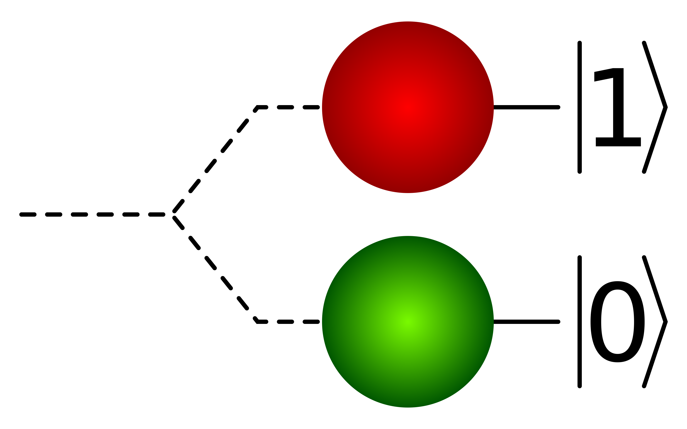
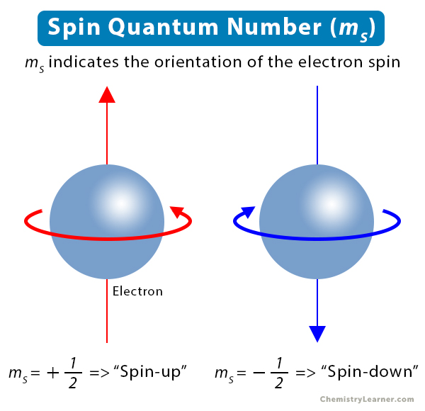

# Quantum Computing

## Overview

In classical computing, bits, which are really just transistors holding charge, can either be in a 0 or 1 state. 

Quantum computing uses **qubits**, which can theoretically exist in a combination of both states at the same time until it is measured or observed which causes it to collapse into a definite classical state of either 0 or 1.

The property of being able to exist in multiple states at once is known as **superposition**. 

Qubits can be linked together in a way such that the state of one instantly influences another, providing massive processing power. This is known as **entanglement**. 

## Qubit

Theoretically, any two-level quantum system can be used to make a qubit. A quantum system is described as two-level when certain system properties can be measured in binary positions, such as up or down.

Qubits have been implemented in a variety of ways
- Superconducting circuits
- Trapped ions
- Photons (particles of light)
- Neutral atoms and silicon spin

A distinction is often made between **physical** qubits (the actual noisy hardware) and **logical** qubits (error-corrected abstractions used for stable computation)

## Dirac Notation

- A.k.a bra-ket / ket notation
- Standard mathematical shorthand used in quantum mechanics to work with vectors 
- Ket $|\phi\rangle$: represents a column vector / a specific quantum state in a complex vector space
- Bra $\langle\phi|$: represents a row vector / a conjugate transpose of a Ket
- Bracket $\langle\Phi|\phi\rangle$: combine a bra and ket to form an inner product, which results in a single complex number, representing a probability amplitude or overlap between states
- Pure vs. Mixed States: Pure states represent complete knowledge of a system described by a single wave function or vector, while mixed states represent statistical ensembles of multiple pure states (described by density matrices)

Core Concepts & Operations
Measurement Collapse: Observing or measuring a quantum state directly forces it to snap to a definite outcome, destroying the prior superposition.
Time Evolution: The changes of a quantum state over time are governed deterministically by the Schrödinger equation.
Quantum Phase: The complex numbers defining a quantum state include a phase angle, which controls how different probability amplitudes interfere with each other constructively or destructively.

How superposition and entanglement work
The difference between bra-ket notation and wave functions
Applications in quantum computing

## Quantum State 

A quantum state is the fundamental mathematical description of a physical system in quantum mechanics. It serves as a complete "container" for all the information that can potentially be known about that system, such as its energy, position, momentum, or spin.

In classical computing, the state of a bit is deterministic—it is either a 0 or a 1. In contrast, a quantum state is probabilistic. Until it is measured, it exists as a superposition of potential outcomes. Think of a classical state like a coin resting on a table (clearly Heads or Tails), while a quantum state is like a coin spinning in mid-air—it embodies the potential for both outcomes simultaneously, defined by a precise probability distribution.

Types of Quantum States in a Quantum System

To accurately describe a quantum system, physicists categorize states into two primary types depending on how much information is known about the system.

    Pure States: A pure state describes a system where we have perfect knowledge of its quantum wavefunction. It is typically represented by a "ket" vector (e.g., $|\psi\rangle$) in Dirac notation. In quantum computing, ideal operations assume we are manipulating pure states.
    
    Mixed States: In the real world, systems interact with their environment (noise), leading to a loss of information. A mixed state represents a statistical ensemble of pure states—essentially, we know the system is in one of several states, but we don't know which one. Mixed states are described using a density matrix rather than a simple vector.
    
    Entangled States: When two or more qubits are linked such that the state of one cannot be described independently of the other, they form an entangled state. This correlation is stronger than anything possible in classical physics and is a key resource for quantum algorithms. (See also: Entanglement)

Quantum Phase and Its Role in Computation

One of the most critical components of a quantum state—and one that has no equivalent in classical logic—is the quantum phase.

If we write a qubit's state as $|\psi\rangle = \alpha|0\rangle + \beta|1\rangle$, the numbers $\alpha$ and $\beta$ are complex numbers. The relationship between them involves a phase angle. While the probabilities of measuring 0 or 1 depend only on the magnitude of these numbers, the phase controls how states interfere with one another.

"Quantum algorithms work by manipulating the quantum phase to create constructive interference for the correct answer and destructive interference for wrong answers."

Mastering phase control is essential for high-fidelity operations. If the phase drifts randomly due to environmental noise (dephasing), the computation fails. This is why coherence time is such a vital metric for any qubit technology.

Measuring a Quantum State: Quantum State Tomography

A fundamental rule of quantum mechanics is that you cannot observe a quantum state directly without collapsing it. If you measure a qubit in superposition, it snaps to either 0 or 1, destroying the complex quantum information it held.

So, how do researchers verify that they have created the correct state? They use a process called quantum state tomography.

Similar to how a medical CT scan builds a 3D image from many 2D X-rays, quantum state tomography reconstructs the quantum stae by repeating the same experiment thousands of times. By measuring the system along different axes (X, Y, and Z bases) across many identical runs, researchers can statistically piece together the full density matrix of the system. This technique is crucial for calibrating hardware and verifying gate fidelity.

## Tensor Product

How to multiply vectors, vector spaces (bases) and matrices.

## Resources

- [Quantum Computers Explained – Limits of Human Technology - Kurzgesagt](https://www.youtube.com/watch?v=JhHMJCUmq28)
- [But what is quantum computing? 3Blue1Brown](https://www.youtube.com/watch?v=RQWpF2Gb-gU) (really good explanation)
- [The biggest lie about the double slit experiment - Looking Glass Universe](https://www.youtube.com/watch?v=fbzHNBT0nl0)
- [Shor's Algorithm for Quantum Computing - Computerphile](https://www.youtube.com/watch?v=k_kyepATqB8)
- [How Qubits Really Work - Qiskit](https://www.youtube.com/watch?v=HSM1GfukQMI)
- [Quantum Computers, explained](https://www.youtube.com/watch?v=e3fz3dqhN44)
- [Introduction to Quantum Mechanics and Quantum Dynamics](https://medium.com/@mihir473/introduction-to-quantum-mechanics-and-quantum-dynamics-59fccf5f82c8)
- [Quantum Computers Explained - Kurzgesagt](https://www.youtube.com/watch?v=JhHMJCUmq28)
- [Quantum State - Wikipedia](https://en.wikipedia.org/wiki/Quantum_state)
- [CS4268 Quantum Computing - Matt's Docs](https://crazoter.github.io/My-Docs/docs/markdown/CS4268)
- [What are...tensor products? VisualMath](https://www.youtube.com/watch?v=8ioUzpYxutQ)
- [The Tensor Product, Demystified. Math3ma](https://www.math3ma.com/blog/the-tensor-product-demystified)
- [QIP 2022 | A Quantum Advantage for a Natural Streaming Problem (John Kallaugher)](https://www.youtube.com/watch?v=KoWkHg6VNxY)

## Glossary

- Quantum Interference
- Double Slit Experiment
- Wave-Particle Duality
- Copenhagen Interpretation, Many-Worlds Interpretation, Decoherence
- Basis State
- Hilbert Space
- Inner Product, Tensor Product
- Hadamard Gate
- Quantum Gate
- Bell State
- Plus, Minus State
- Quantum Entanglement
- Wave function collapse / Measurement Problem
- Superposition
- Born Rule
- Grover's Algorithm, Shor's Algorithm
- No-communication theorem / No-signalling principle
- Superconducting circuits
- Qubit Decay, T1 time, T2 time / de-phasing
- Schrödinger's Equation
- Quantum Tunneling
